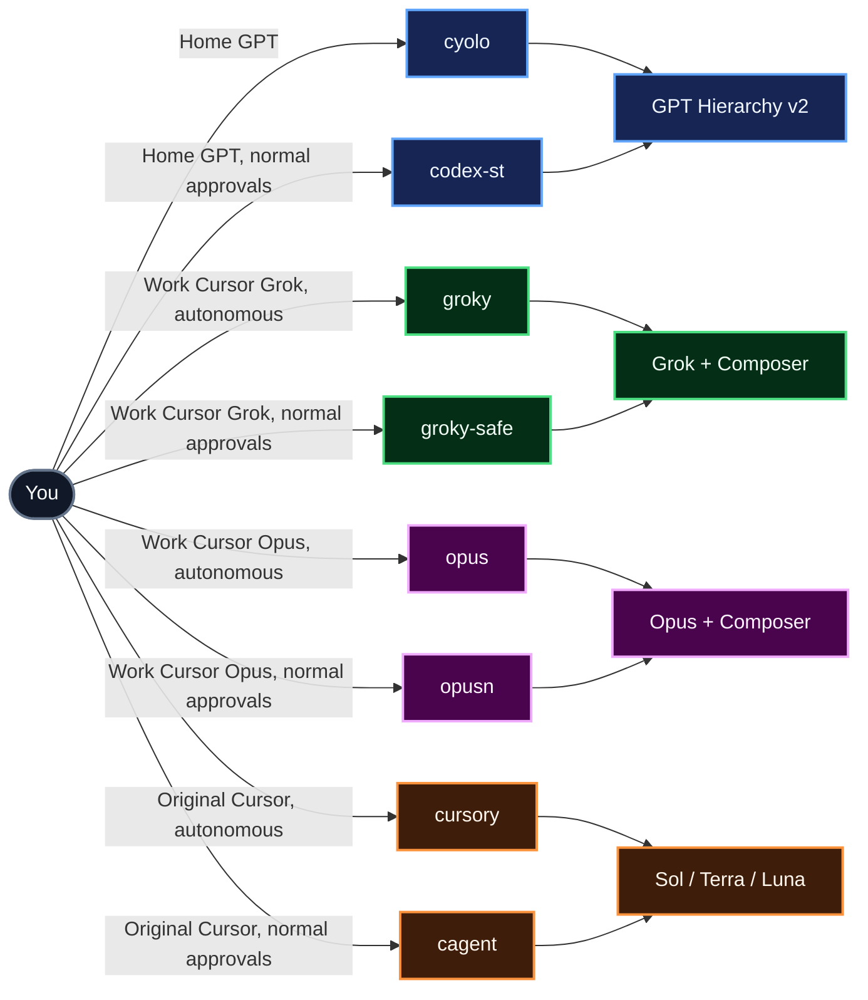
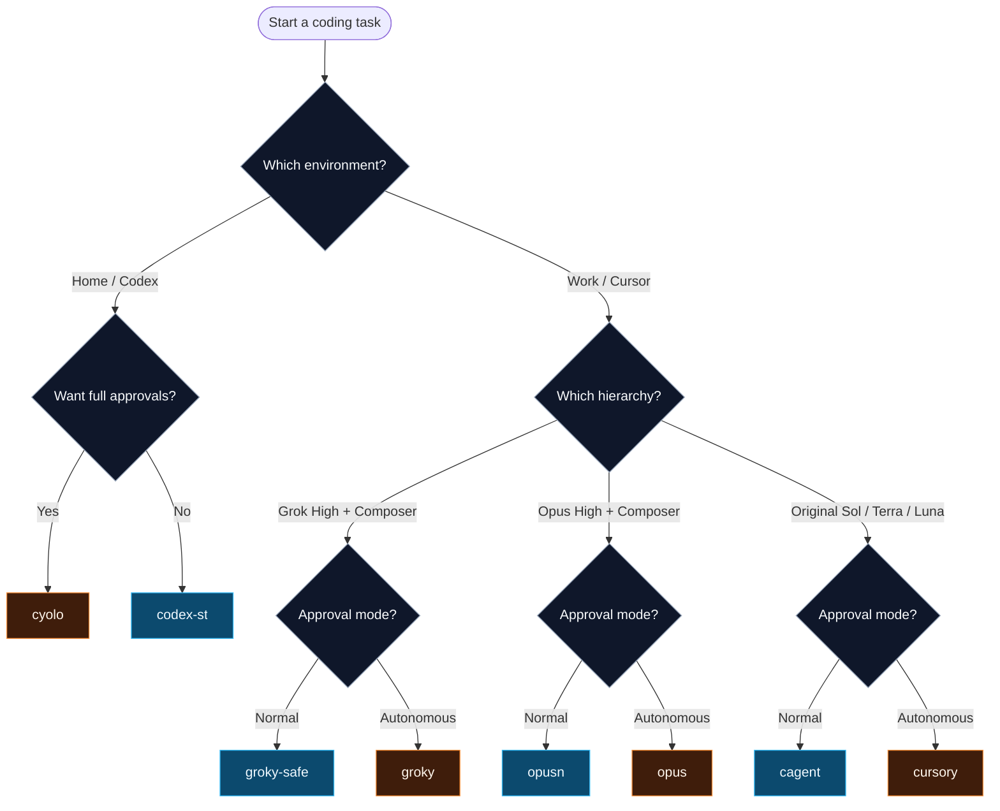
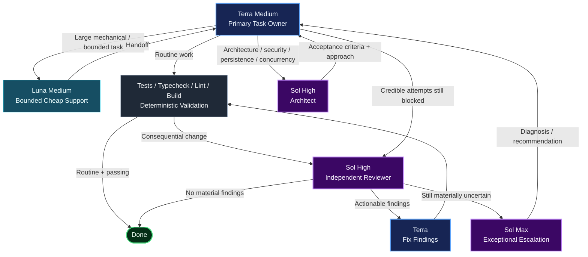
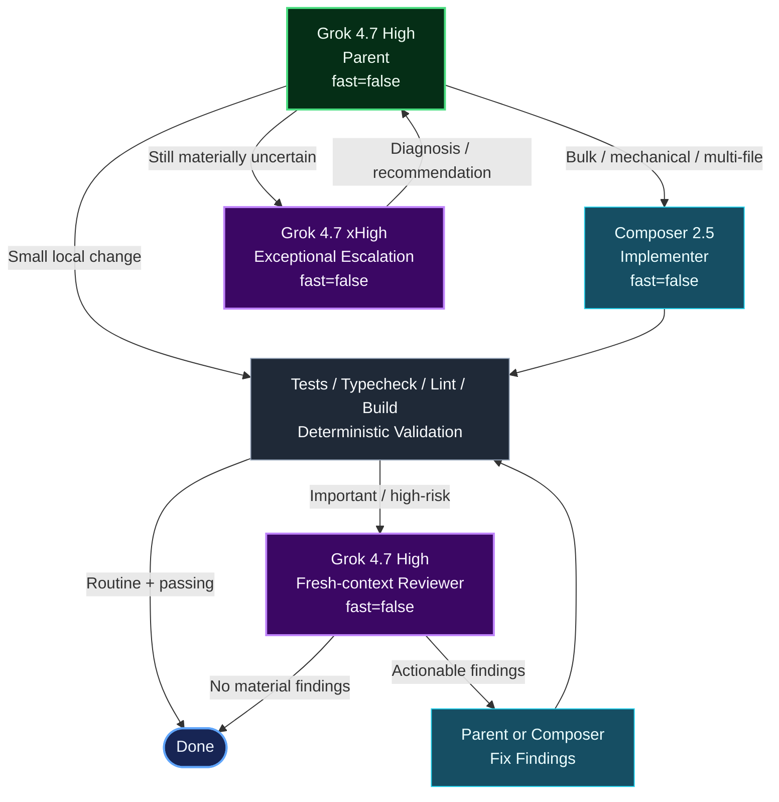
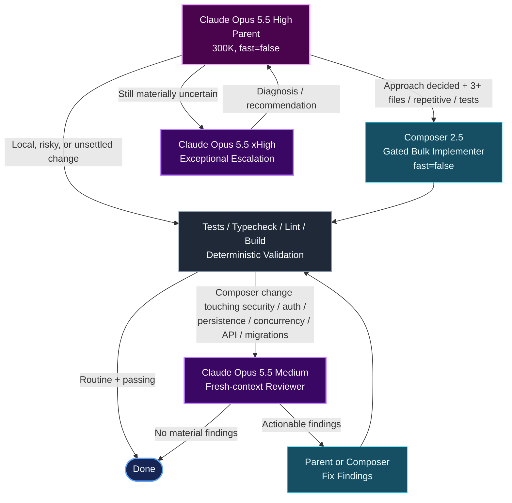
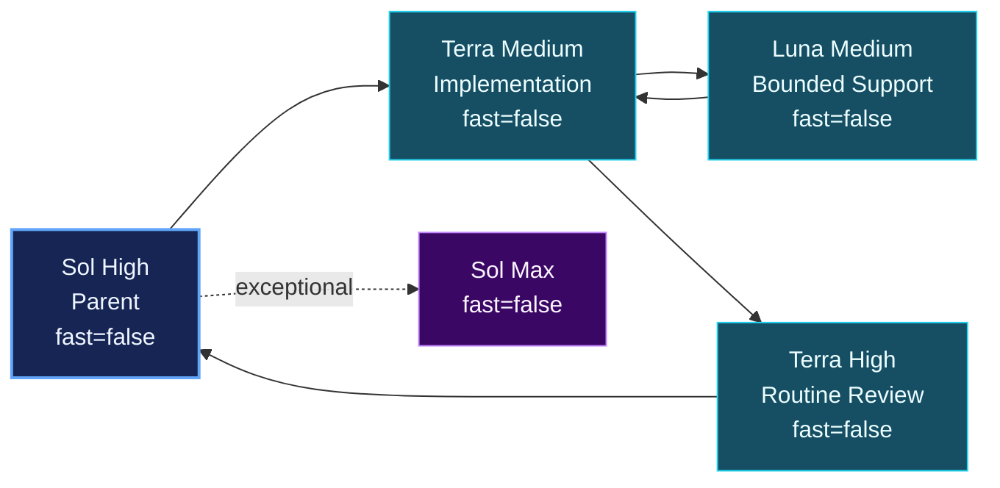

# AI CLI dotfiles

Portable Linux/WSL configuration for opinionated Cursor and Codex CLI workflows: guarded launchers, model hierarchies, reusable agent roles, shell aliases, validation rules, and safe install/backup tooling.

> **Core idea:** keep routine work with the cheapest capable owner, use deterministic validation early, and spend expensive reasoning only when it materially improves the probability of success.

## At a glance

| Workflow | Primary command | Normal/safe command | Default owner | Senior reasoning | Use case |
| --- | --- | --- | --- | --- | --- |
| **GPT Hierarchy v2** | `cyolo` | `codex-st` | Terra Medium | Sol High / Sol Max | Home Codex workflow |
| **Groky** | `groky` | `groky-safe` | Grok 4.7 High | Composer 2.5 / Grok xHigh | Grok-led Cursor workflow |
| **Opus** | `opus` | `opusn` | Claude Opus 5.5 High | Composer 2.5 / Opus xHigh | Opus-led Cursor workflow |
| **Original Cursor** | `cursory` | `cagent` | Sol High | Sol Max | Legacy Sol/Terra/Luna Cursor workflow |

### Launcher map



## Which launcher should I use?



---

# GPT Hierarchy v2 — home Codex workflow

The optimized home hierarchy is Terra-led. Routine tasks stay in one Terra context; Luna is opportunistic; Sol High is conditional; Sol Max is exceptional.

### Architecture



### Routing contract

```text
Routine:
  Terra -> validate -> diff inspection -> done

Bounded cheap support:
  Terra -> Luna -> Terra verifies/integrates -> validate -> done

Important:
  Terra -> validate -> Sol High reviewer -> Terra fixes -> validate -> done

Architectural:
  Sol High architect -> Terra implements -> validate -> Sol High reviewer -> done

Exceptional:
  Terra attempts -> Sol High diagnosis -> Sol Max only if material uncertainty remains
```

| Role | Model + effort | Responsibility |
| --- | --- | --- |
| Terra parent | `gpt-5.6-terra` + medium | Default owner: inspect, implement, test, debug, integrate, self-review |
| Luna worker | `gpt-5.6-luna` + medium | Optional isolated low-risk/mechanical support |
| Terra reviewer | `gpt-5.6-terra` + high | Optional routine second pass, mainly for Luna work |
| Sol architect | `gpt-5.6-sol` + high | Architecture and acceptance criteria for consequential changes |
| Sol reviewer | `gpt-5.6-sol` + high | Independent integrated-diff review |
| Sol Max advisor | `gpt-5.6-sol` + max | Exceptional escalation only |

### Commands

```bash
# Normal Codex approvals / sandbox
codex-st "Implement the requested change and validate it."

# Canonical full-approval home GPT alias
cyolo "Implement the reviewed change and validate it."
```

`cyolo` expands to:

```bash
codex-st --dangerously-bypass-approvals-and-sandbox
```

`codexy` remains only as a backward-compatible alias for the same command.

See [`codex/HIERARCHY.md`](codex/HIERARCHY.md) and [`codex/prompts/terra-led-workflow.md`](codex/prompts/terra-led-workflow.md).

---

# Groky — Grok 4.7 High + Composer 2.5 Cursor workflow

Groky is the Grok-led work hierarchy: Grok 4.7 High owns inspection, architecture, routing, small local edits, and signoff; Composer 2.5 implements bulk work; Grok High review and xHigh escalation remain conditional.

### Architecture



### Routing contract

```text
Routine:
  Grok High parent -> small local edit or Composer bulk implement
    -> validate -> diff inspection -> done

Important:
  Parent/Composer implement -> validate -> Grok High reviewer
    -> parent/Composer fixes -> validate -> done

Architectural:
  Grok High parent plans -> Composer implements -> validate
    -> Grok High reviewer -> done

Exceptional:
  Grok xHigh only after credible Grok High parent attempts
```

Advisor and architect roles are folded into the Grok High parent.

### Fast mode policy: always off

Every managed Cursor model is explicitly non-Fast.

| Role | Model |
| --- | --- |
| Grok High parent | `grok-4.7-high` |
| Composer implementer | `composer-2.5[fast=false]` |
| Grok reviewer | `grok-4.7-high` |
| Grok escalation | `grok-4.7-xhigh` |
| Explore | `composer-2.5[fast=false]` |

`cursor-st --groky` launches with `--model grok-4.7-high` so the CLI cannot fall back to Auto / Auto Balance. Grok 4.7 is catalogued as discrete effort and speed slugs (`grok-4.7-high`, `grok-4.7-high-fast`, `grok-4.7-xhigh`); the managed path uses the non-Fast IDs. It also rewrites the selected parent to `grok-4.7-high` in `cli-config.json` before startup and keeps Explore on non-Fast Composer. Composer stays on `composer-2.5[fast=false]`, and the doctor rejects a Fast Grok slug or a Composer pin that lacks `fast=false`. Built-in/automatic subagents are not part of the managed Groky path when their speed variant cannot be verified.

Install removes leftover `grok-advisor` and `grok-architect` files. On launch, Groky replaces stale generated project copies of `global-groky-routing.mdc` from older templates instead of refusing to start.

### Commands

```bash
# Normal Cursor approval behavior
groky-safe "Implement the requested change and validate it."

# Full-autonomy work workflow
groky "Implement the reviewed change and validate it."
```

See [`cursor/GROKY.md`](cursor/GROKY.md) and [`cursor/prompts/groky-workflow.md`](cursor/prompts/groky-workflow.md).

---

# Opus — Claude Opus 5.5 High + Composer 2.5 Cursor workflow

Opus is the Opus-led work hierarchy: Claude Opus 5.5 High (300K context) owns inspection, architecture, routing, risky or unsettled edits, and signoff; Composer 2.5 writes gated bulk work; Opus review and xHigh escalation remain conditional.

### Architecture



### Routing contract

```text
Routine:
  Opus High parent implements, or delegates gated bulk work to Composer
  (approach decided; 3+ files, repetitive, or mostly tests/fixtures)
    -> validate -> diff inspection -> done

Consequential review:
  Composer-written change touching security, auth, persistence,
  concurrency, public API, or migrations -> validate -> Opus reviewer
    -> parent/Composer fixes -> validate -> done

Stalled:
  Opus xHigh only after credible Opus High parent attempts
```

Small parent-written edits do not require the reviewer. Security, auth, persistence, concurrency, public API, migration, and unsettled design work stays with the parent.

### Fast mode policy: always off

Every managed Cursor model is explicitly non-Fast.

| Role | Model |
| --- | --- |
| Opus High parent | `claude-opus-5-5-high` (config: `claude-opus-5-5`, `context=300k`, `effort=high`, `fast=false`) |
| `opus-composer` | `composer-2.5[fast=false]` |
| `opus-reviewer` | `claude-opus-5-5-medium` |
| `opus-escalation` | `claude-opus-5-5-xhigh` |
| Explore | `composer-2.5[fast=false]` |

`cursor-st --opus` launches with `--model claude-opus-5-5-high` so the CLI cannot fall back to Auto / Auto Balance. Opus 5.5 is catalogued as discrete effort and speed slugs (`claude-opus-5-5-high`, `claude-opus-5-5-high-fast`, `claude-opus-5-5-xhigh`); the managed path uses the non-Fast IDs. It also rewrites the selected parent in `cli-config.json` to `claude-opus-5-5` with `context=300k`, `effort=high`, `fast=false`, and pins Explore to non-Fast Composer. The doctor rejects a Fast Opus slug or a Composer pin that lacks `fast=false`.

### Commands

```bash
# Normal Cursor approval behavior
opusn "Implement the requested change and validate it."

# Full-autonomy work workflow
opus "Implement the reviewed change and validate it."
```

See [`cursor/OPUS.md`](cursor/OPUS.md) and [`cursor/prompts/opus-workflow.md`](cursor/prompts/opus-workflow.md).

---

# Cursor workflow isolation

Each Cursor mode renders only its own routing rule into the project and removes the others:

| Mode | Project routing rule | Project agents |
| --- | --- | --- |
| Sol/Terra/Luna (`cagent`, `cursory`) | `global-model-routing.mdc` | `global-sol-planner`, `global-terra-*`, `global-luna-worker` |
| Groky (`groky`, `groky-safe`) | `global-groky-routing.mdc` | `global-groky-*` |
| Opus (`opus`, `opusn`) | `global-opus-routing.mdc` | `global-opus-*` |

The user-level templates (`model-routing.mdc`, `groky-routing-template.mdc`, `opus-routing-template.mdc`) stay dormant with `alwaysApply: false`, so hierarchies never collide in one session. Generated project files are excluded through `.git/info/exclude`, and `cursor-st --clean-project` removes them for all three modes. No project routing rule is injected when the workspace root is `$HOME`.

Current Cursor CLIs accept only `default` / `inherit` in `exploreSubagentModel`, so every mode sets it to `default` and pins the Explore model through `subagentModels.explore`.

---

# Original Cursor — Sol / Terra / Luna

The original managed Cursor hierarchy remains available for compatibility.



```bash
cagent     # normal approvals
cursory    # cursor-st --yolo
```

All managed models in this Cursor hierarchy are also pinned to `fast=false`, including Explore (`gpt-5.6-sol`, reasoning high).

---

## Command matrix

| Command | CLI | Hierarchy | Approval behavior | Recommended use |
| --- | --- | --- | --- | --- |
| `cyolo` | Codex | GPT Hierarchy v2 | Full bypass | Home trusted/sandboxed execution |
| `codex-st` | Codex | GPT Hierarchy v2 | Normal | Home standard use |
| `groky` | Cursor | Grok High + Composer | `--yolo` | Work trusted autonomous execution |
| `groky-safe` | Cursor | Grok High + Composer | Normal | Work standard use |
| `opus` | Cursor | Opus High + Composer | `--yolo` | Work trusted autonomous execution |
| `opusn` | Cursor | Opus High + Composer | Normal | Work standard use |
| `cursory` | Cursor | Sol/Terra/Luna | `--yolo` | Legacy Cursor autonomous mode |
| `cagent` | Cursor | Sol/Terra/Luna | Normal | Legacy Cursor standard mode |
| `codexy` | Codex | GPT Hierarchy v2 | Full bypass | Compatibility alias for `cyolo` |
| `cdx` | Codex | Raw Codex | Native | Intentionally bypass managed hierarchy |

## Installation

Prerequisites: Linux or WSL, Bash, Python 3.11+, Git, `rg`, and the official Cursor and/or Codex CLI already installed and authenticated.

```bash
git clone git@github.com:YOUR-ACCOUNT/ai-cli-dotfiles.git
cd ai-cli-dotfiles

./doctor.sh --repo-only
./tests/smoke-test.sh
git diff --check

./install.sh --dry-run
./install.sh
source ~/.bashrc
./doctor.sh
```

Useful install options:

| Option | Effect |
| --- | --- |
| `--copy` | Install independent copies instead of symlinks |
| `--cursor-only` | Install Cursor assets and shared aliases only |
| `--codex-only` | Install Codex assets and shared aliases only |
| `--replace-config` | Back up and replace the Codex base config template |
| `--force` | Replace a protected changed/unrecognized target after backup |
| `--full-access` | Store Cursor unrestricted approval/disabled sandbox preferences |

## Inspect the active workflows

```bash
# Original Cursor
cursor-st --show-flow
cursor-st --doctor

# Groky
cursor-st --groky --show-flow
cursor-st --groky --doctor

# Opus
cursor-st --opus --show-flow
cursor-st --opus --doctor

# GPT Hierarchy v2
codex-st --show-flow
codex-st --doctor

# Alias helper
cdoctor
```

## Installed mappings

| Repository source | Destination |
| --- | --- |
| `cursor/agents/*.md` | `~/.cursor/agents/` |
| `cursor/rules/*.mdc` | `~/.cursor/rules/` |
| `cursor/hooks.json` | merged into `~/.cursor/hooks.json` |
| `cursor/cli-config.json` | selected portable fields merged into `~/.cursor/cli-config.json` |
| `bin/cursor-st` | `~/.local/bin/cursor-st` |
| `codex/AGENTS.md` | `~/.codex/AGENTS.md` |
| `codex/rules/default.rules` | `~/.codex/rules/default.rules` |
| `codex/config/sol-terra-luna.config.toml` | `~/.codex/sol-terra-luna.config.toml` |
| `codex/agents/*.toml` | `~/.codex/agents/` |
| `codex/config/config.toml` | `~/.codex/config.toml` only if missing or explicitly replaced |
| `bin/codex-st` | `~/.local/bin/codex-st` |
| `shell/ai-cli-aliases.sh` | `${XDG_CONFIG_HOME:-$HOME/.config}/ai-cli-dotfiles/ai-cli-aliases.sh` |

`CURSOR_HOME`, `CODEX_HOME`, `XDG_STATE_HOME`, and `XDG_CONFIG_HOME` are honored where applicable.

## Maintenance and recovery

```bash
./doctor.sh --repo-only
./tests/smoke-test.sh
git diff --check

./backup-current.sh
./backup-current.sh --include-codex

./uninstall.sh --dry-run
./uninstall.sh --restore
```

The backup workflow preserves Cursor's selected-model `fast=false` parameter and, when present, the Grok `effort` parameter.

## Security

Never commit credentials, authentication JSON, private keys, `.env` files, sessions, logs, model history, local databases, machine trust entries, or other secrets.

The repository scanner is a guardrail, not permission to commit sensitive material. High-autonomy aliases (`cyolo`, `groky`, `opus`, `cursory`) should only be used in trusted or appropriately sandboxed environments.

Repository validation proves the portable configuration is internally consistent; it does not prove account access, model availability, or that unrestricted execution is safe in a particular project.
