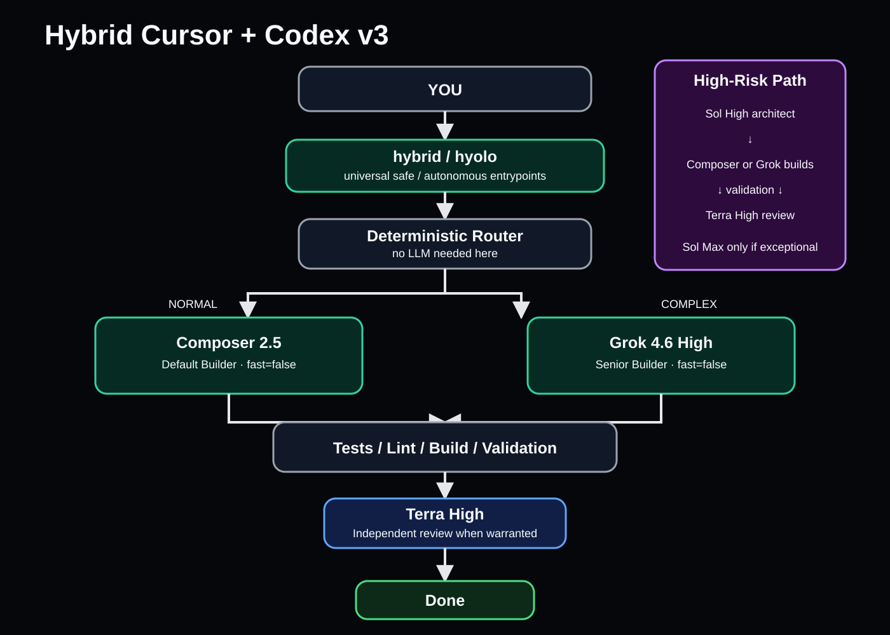
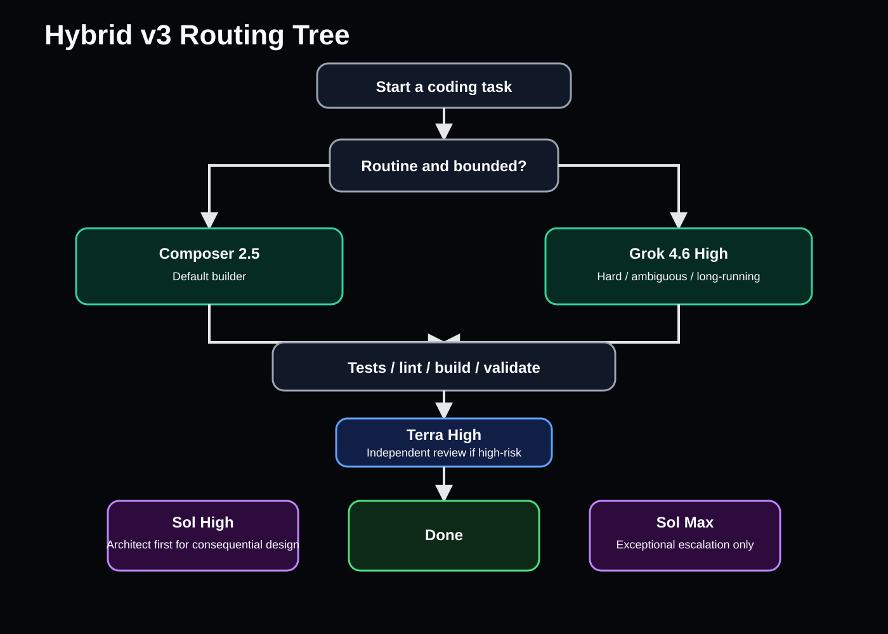
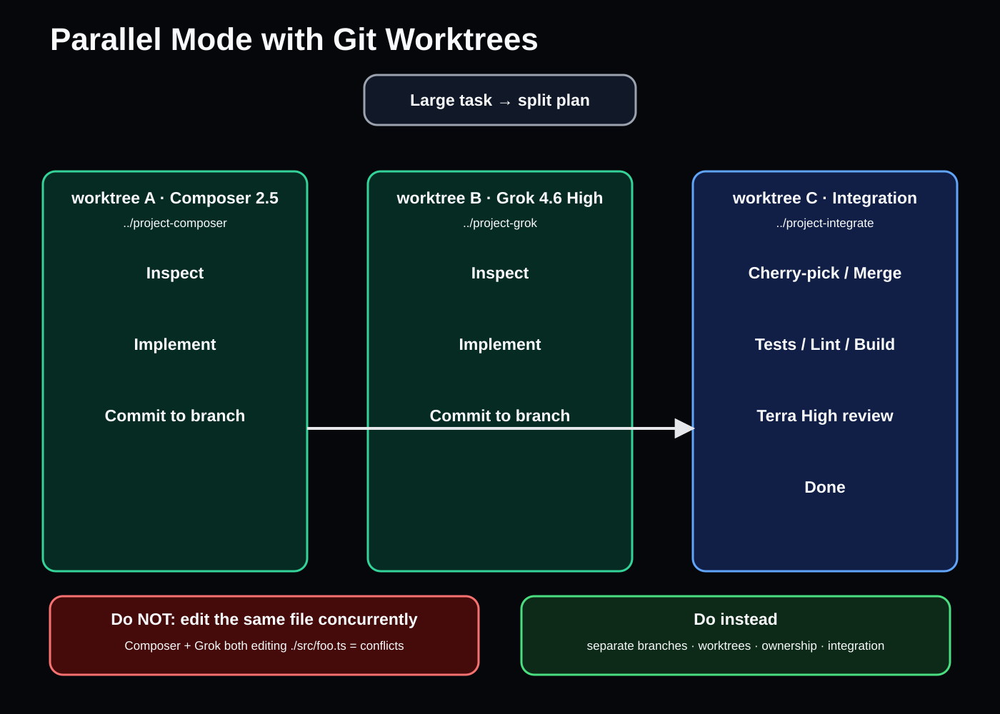
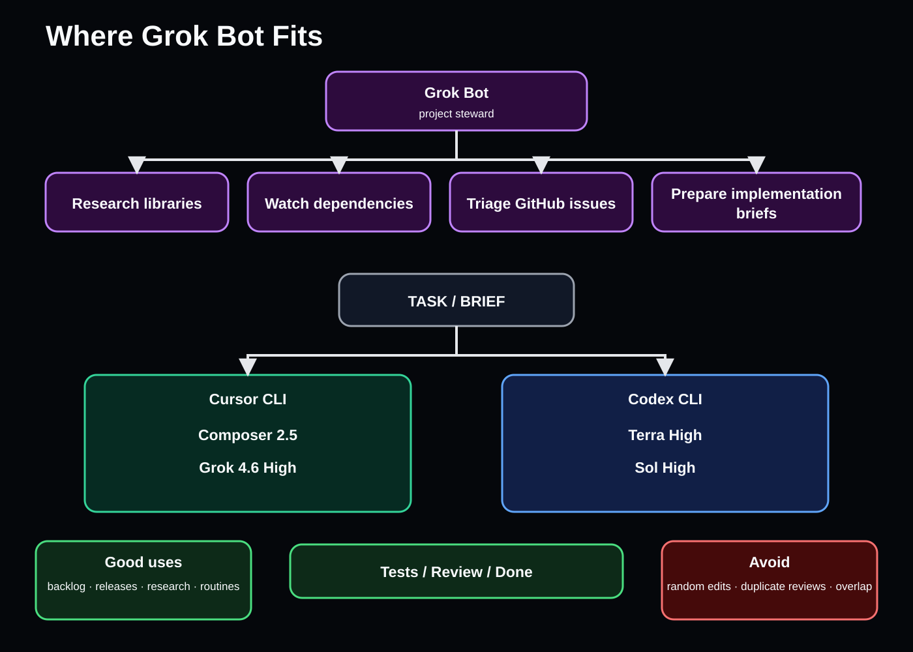
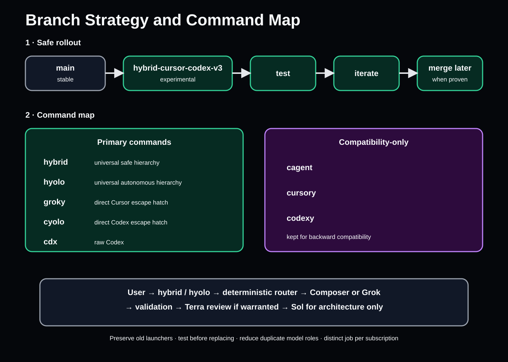

# Hybrid Cursor + Codex v3 — Visual Guide

These diagrams document the experimental `hybrid-cursor-codex-v3` workflow. The SVG files are the repo-friendly rendered visuals; the Mermaid sources remain editable and version-controlled.

## 1. Hybrid v3 overview

Source: [`mermaid/hybrid-v3-overview.mmd`](mermaid/hybrid-v3-overview.mmd)

**Core rule:** Composer builds normal work, Grok builds the hard work, Terra independently reviews important diffs, Sol makes consequential architectural decisions, and Sol Max is exceptional escalation only.

## 2. Routing tree

Source: [`mermaid/routing-tree.mmd`](mermaid/routing-tree.mmd)

Use Composer 2.5 for bounded routine work. Route difficult, ambiguous, or long-running implementation to Grok 4.6 High. Use Terra High only when independent review materially improves confidence. Use Sol High before consequential architecture/security/persistence/concurrency/public-API decisions.

## 3. Parallel mode with Git worktrees

Source: [`mermaid/parallel-worktrees.mmd`](mermaid/parallel-worktrees.mmd)

Parallel writers must use separate branches/worktrees and explicit ownership. Integrate deterministically, validate the combined result, then use Terra High for an independent review when warranted.

## 4. Where Grok Bot fits

Source: [`mermaid/grok-bot-fit.mmd`](mermaid/grok-bot-fit.mmd)

Grok Bot sits above the local coding loop as a project steward: research, dependency monitoring, GitHub triage, backlog work, and implementation briefs. Keep it out of overlapping hot-path edits and duplicate review loops.

## 5. Branch strategy and command map

Source: [`mermaid/branch-strategy-command-map.mmd`](mermaid/branch-strategy-command-map.mmd)

The rollout keeps `main` stable while the hybrid workflow is built and validated on `hybrid-cursor-codex-v3`. Proposed primary commands are `hybrid` and `hyolo`; existing direct launchers remain available as escape hatches or compatibility aliases during migration.

## Asset map

| Diagram | SVG | Editable source |
| --- | --- | --- |
| Hybrid overview | `assets/hybrid-v3-overview.svg` | `mermaid/hybrid-v3-overview.mmd` |
| Routing tree | `assets/routing-tree.svg` | `mermaid/routing-tree.mmd` |
| Parallel worktrees | `assets/parallel-worktrees.svg` | `mermaid/parallel-worktrees.mmd` |
| Grok Bot placement | `assets/grok-bot-fit.svg` | `mermaid/grok-bot-fit.mmd` |
| Branch / command map | `assets/branch-strategy-command-map.svg` | `mermaid/branch-strategy-command-map.mmd` |
